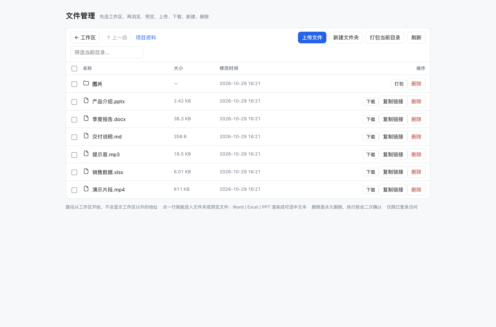
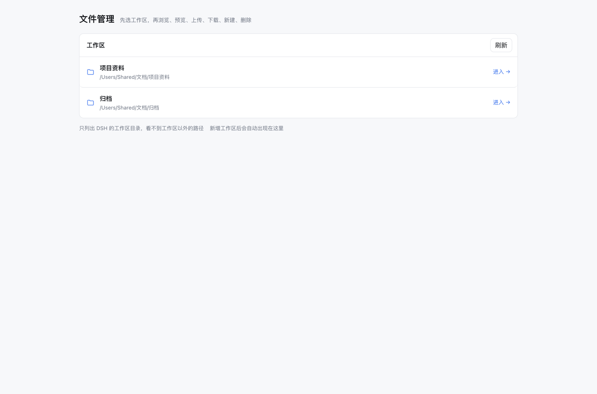
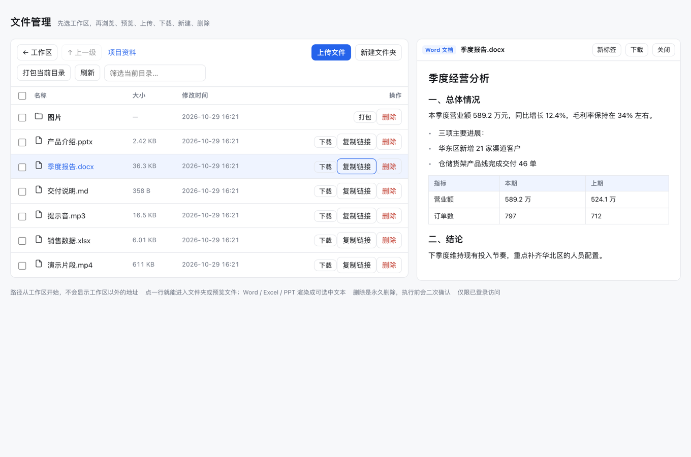
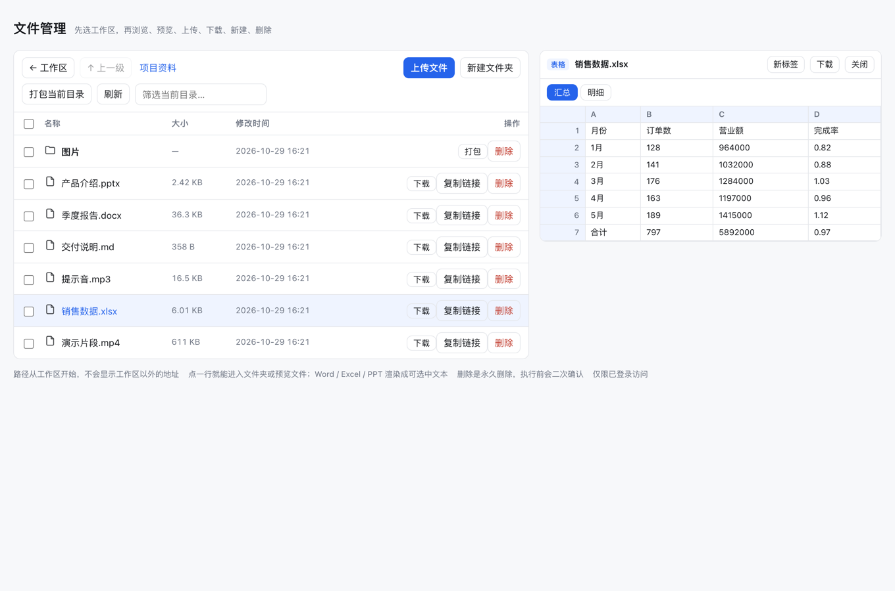
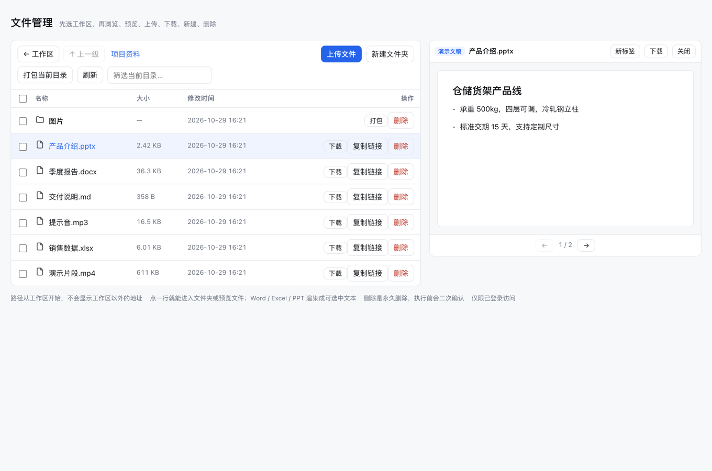

# dsh-file-download

[](https://github.com/mrouyang4/dsh-file-download/actions/workflows/check.yml)

给 **DSH（DeepSeek Harness）Web** 加一套「在浏览器里管文件」的能力：浏览、下载、上传、新建文件夹、目录打包、永久删除，以及聊天产出卡片与右侧预览面板的一键下载。

DSH 的进程和文件都在宿主机（跑 `dsh web` 的那台机器）上，而浏览器经常是从另一台设备远程打开的。聊天里的文件卡片、预览面板只在宿主机上有意义——远程浏览器既打不开也拿不到。这个插件补一条同源、带登录态保护的 HTTP 通道，外加一个自带的文件管理页。

- 无需额外服务、无第三方依赖、不需要构建
- 左侧新增「文件管理」入口：两级目录（工作区 → 目录），路径不越出工作区
- **点一行就用**：文件夹行点进去、文件行就地预览（0.7.0 起没有「打开」「预览」按钮）
- 预览很认真：Word 的段落/标题/表格、Excel 的工作表标签与网格、PPT 的逐页翻页都是**真正文**，
  可选中、跟随明暗主题；PDF / 图片 / 文本 / 视频 / 音频按浏览器原生能力渲染，视频可拖进度条
- 聊天里的产出卡片、`⋯` 菜单、右侧预览面板都长出一个「下载到本地」



---

## 目录

- [安装](#安装)
- [符合 DSH 插件规范](#符合-dsh-插件规范)
- [截图](#截图)
- [用法](#用法)
  - [1. 侧边栏「文件管理」](#1-侧边栏文件管理)
  - [2. 浏览与导航](#2-浏览与导航)
  - [3. 上传](#3-上传)
  - [4. 新建文件夹](#4-新建文件夹)
  - [5. 下载单个文件](#5-下载单个文件)
  - [6. 打包整个目录](#6-打包整个目录)
  - [7. 复制直链](#7-复制直链)
  - [8. 删除](#8-删除)
  - [9. 产出卡片上的下载按钮](#9-产出卡片上的下载按钮)
  - [10. 卡片-菜单里的「下载到本地」](#10-卡片--菜单里的下载到本地)
  - [11. 右侧预览面板的下载按钮](#11-右侧预览面板的下载按钮)
  - [12. 聊天里的下载链接](#12-聊天里的下载链接)
  - [13. 直接拼 URL](#13-直接拼-url)
  - [14. 页内预览（0.6.0 / 0.7.0）](#14-页内预览)
  - [15. 行的交互与批量选择](#15-行的交互与批量选择)
- [配置](#配置)
- [HTTP 路由](#http-路由)
- [安全边界](#安全边界)
- [更新记录](#更新记录)
- [故障排查](#故障排查)
- [兼容性与已知限制](#兼容性与已知限制)
- [开发](#开发)
- [License](#license)

---

## 安装

假设 DSH 的插件目录是 `~/.dsh/plugins`，Web profile 是 `web`。

**1. 放源码**

```bash
git clone https://github.com/mrouyang4/dsh-file-download.git ~/.dsh/plugins/dsh-file-download
```

**2. 声明依赖** — `~/.dsh/profiles/web/package.json`

```json
{
  "dependencies": {
    "dsh-file-download": "file:/Users/you/.dsh/plugins/dsh-file-download"
  }
}
```

> `file:` 后面写**绝对路径**，不要用 `$HOME`（npm 不会展开变量）。

**3. 挂载插件** — `~/.dsh/profiles/web/cordis.patch.yml`

```yaml
- insert:
    - id: dsh-file-download
      name: dsh-file-download
```

**4. 让 `node_modules` 指到源码**

```bash
ln -s ~/.dsh/plugins/dsh-file-download ~/.dsh/profiles/web/node_modules/dsh-file-download
```

插件没有构建步骤，软链过去就能用。

**5. 重启 DSH Web**，刷新页面。左侧导航出现「文件管理」，即安装成功。

> 之后：改 `lib/` 需要重启 DSH；只改 `client/client.js` 刷新页面即可（客户端 bundle 每次请求重新生成，带内容哈希）。

---

## 符合 DSH 插件规范

这是一个标准 DSH 插件（Cordis 插件 + web 客户端 bundle + locale 字典），不是外挂脚本。逐条对照如下，全部可用 `node scripts/conformance.mjs` 复核（CI 每次 push 都会跑）。

| 规范要求 | 本插件的实现 |
|---|---|
| 宿主入口导出 `name` | `lib/index.js:31` — `export const name = "dsh-file-download"`，与包名一致 |
| 声明依赖的宿主服务 `inject` | `lib/index.js:34` — `export const inject = ["connection", "webServer"]` |
| 导出 `apply(ctx, config)` 作为生命周期入口 | `lib/index.js:528` — `export function apply(ctx, config = {})` |
| 注册即受管，卸载即摘除 | 路由与页面都包在 `ctx.effect(() => { ... return dispose })` 里，插件停用时自动注销 6 条 API 与 `/files` |
| 配置 schema（可选项） | 未声明 `Config`。`config.roots` 在 `makeRoots()` 内按 `Array.isArray` 校验，非法值退回工作区列表，不会因错误配置抛错 |
| 宿主入口声明 | `package.json` → `main: "lib/index.js"`，`exports["."]` 指向同一文件 |
| 客户端入口声明 | `exports["./client"]` → `client/client.js` |
| web 客户端声明 | `dsh.client.platform: "web"`；`dsh.client.inject: ["@deepseek-ai/dsh-client-ui-sidebar"]` 声明它扩展的是侧边栏插件 |
| 客户端 bundle 形态 | `client/client.js` 是 `window.__ModuleLoader__.load({ id: "dsh-file-download", factory })`，`id` 与包名一致，导出 `name` / `apply` / `inject` |
| 清单可被外部读取 | `exports["./package.json"]`，便于 DSH 读取版本与 `dsh` 段 |
| 本地化字典 | `locale/zh.json` + `locale/en.json`，两份 `meta.title` / `meta.description` 键集一致（插件列表里的名称与说明就来自这里） |
| 宿主版本兼容声明 | `peerDependencies["@deepseek-ai/cordis"]: "~4.0.5"`，DSH 的安装与启动版本检查以此为准 |
| 只依赖公开入口 | 宿主侧只 import `node:` 内置模块与本地文件，不深入 DSH 内部私有模块 |
| 鉴权围栏 | 所有 `/api/*` 经 `connection` 服务（cookie 鉴权 + Host/Origin 栅栏），`/files` 走 `ctx.connection.requestRejection`，未登录 401、跨界 403 |

自检：

```bash
node scripts/conformance.mjs     # 16 项规范检查
./scripts/check.sh               # 语法 + JSON + zip 冒烟 + 上面这 16 项
```

输出形如：

```
ok    host.name                   dsh-file-download
ok    host.inject                 connection, webServer
ok    host.apply                  injects 2 services
ok    exports["./client"]         ./client/client.js
ok    dsh.client.platform         web
ok    client loader               __ModuleLoader__.load
ok    locale                      zh + en (description,title)

符合 DSH 插件规范：16 项全部通过
```

## 截图

以下截图都来自真实运行中的 DSH Web，演示文件是为此临时生成的样例（工作区指向两个示例目录）。

### 工作区列表

首页只列 DSH 里挂载的工作区，不显示 `/Users/...` 之外的任何上级路径。



### 浏览目录

面包屑从工作区名开始；工具栏是返回、上传、新建、打包、刷新、筛选；每一行左边是选择框，右边是该行自己的操作。


### Word 预览（结构化，真文本）

标题层级、段落、无序列表、表格都在，文字可以选中、复制，字号跟随页面主题。



### Excel 预览（工作表标签 + 网格）

底部是工作表标签，左侧行号、顶部列标，宽表可以横向滚动，单元格悬停显示完整内容。



### 幻灯片预览（逐页翻页）

按 `presentation.xml` 的页序翻页，`←` `→` 键也能翻；标题、副标题、正文分层显示。



### 图片预览

图片走浏览器原生 ``，右上角可「新标签」打开原图。


### 视频预览

`<video controls>` 直接吃 `inline=1` 的 Range 流，可以拖进度条、全屏。


### 批量选择

左侧复选框选中若干项后，表格上方出现工具条：条数、合计大小、全选、反选、清空、批量下载/移动/删除。


---

## 用法

### 1. 侧边栏「文件管理」

左侧导航里点 **文件管理**（齿轮区，排在「自动化任务」之后）。主区打开插件自带的文件管理页。

首页是**工作区列表**，不是文件系统根目录：

```
┌ 工作区 ──────────────────────────────────────┐
│  📁 项目资料         /Users/you/项目资料      [进入 →] │
│  📁 归档             /Users/you/归档          [进入 →] │
└──────────────────────────────────────────────┘
只列出 DSH 的工作区目录，看不到工作区以外的路径
```

列表来自 DSH 的工作区注册表，**新增工作区后这里会自动出现**（点右上「刷新」即时更新）。

### 2. 浏览与导航

进入某个工作区后：

| 操作 | 位置 | 结果 |
|---|---|---|
| 进子目录 | **点目录那一行**（0.7.0 起；键盘 `Enter` / `Space` 同样可以） | 面包屑变成 `AI-Job / _demo-office` |
| 回上级 | 工具栏「↑ 上一级」 | 工作区根处按钮置灰，无法再往上 |
| 换工作区 | 工具栏「← 工作区」 | 回到工作区列表 |
| 找文件 | 工具栏「筛选当前目录…」 | 按名称实时过滤，输入 `pdf` 只看 PDF |
| 刷新 | 工具栏「刷新」 | 重新拉取当前目录 |

面包屑**从工作区名开始**，永远不会出现 `/Users/...` 这样的上级路径——这也是插件的路径边界在界面上的体现。

### 3. 上传

两种方式，都上传到**当前目录**：

- 点工具栏 **上传文件** → 选一个或多个文件
- 直接把文件**拖进页面**（整页都是放置区，松手即传）

细节：

- 同名文件默认**不覆盖**，返回 `409`，界面提示已存在；需要覆盖时接口加 `overwrite=1`
- 先写 `<文件名>.part-<随机后缀>`，写完后原子改名，中途断掉不会留下半截正式文件
- 上传过程中按钮显示进度；完成后列表自动出现该文件

### 4. 新建文件夹

点 **新建文件夹** → 输入名称 → 回车。重名返回 `409` 并在界面提示。

名称只能是一个路径段：`/`、`\`、`..`、空字节、超过 255 字符都会被拒绝（防止借名字越界）。

### 5. 下载单个文件

文件行尾点 **下载**：浏览器按宿主机的真实文件名保存（中文名正常，走 RFC 5987）。
行尾按钮不会顺带触发行的点击（都 `stopPropagation`），下载的同时不会莫名其妙弹开预览。

- 大文件流式传输，支持 `Range` 断点
- 想**在浏览器里直接看**而不是下载（PDF / 图片）：用「复制链接」拿到的地址后面加 `&inline=1`

### 6. 打包整个目录

- 目录行尾 **打包** → 下载 `<目录名>.zip`
- 工具栏 **打包当前目录** → 下载当前所在目录的 zip

实现是自己写的流式 STORE zip（`lib/zip.js`）：边读边写，内存只占一个 chunk，不依赖 `zip`/`archiver`；单文件上限 4 GiB。

### 7. 复制直链

行尾 **复制链接** 把 `/api/files.download?path=<绝对路径>` 写入剪贴板，可以贴到任何需要的地方（比如 Markdown 里 ``）。链接继承浏览器登录态，**未登录访问会 401**。

### 8. 删除

行尾 **删除** → 弹窗「永久删除「文件名」？」→ 点 **永久删除** 才执行。

- 是**真删除**（`rm -rf`），不进回收站，删完不可恢复
- 目录会连同内容一起删
- 工作区根目录本身拒绝删除

### 9. 产出卡片上的下载按钮

DSH 把 agent 生成的文档显示成卡片（Word/Excel/PDF 图标那种）。插件在卡片右侧、预览按钮旁边加一个 **⤓ 下载** 按钮：

1. 在对话里找到产出卡片
2. 点卡片右侧的 ⤓（在「预览」和 `⌄` 之间）
3. 浏览器直接下载该文件

按钮只对**宿主机上真实存在**的产出出现；路径取自卡片自带的信息，不额外发请求。

### 10. 卡片 `⋯` 菜单里的「下载到本地」

卡片右侧 `⌄` 展开的菜单，宿主原来列的是「用 WPS/Word/LibreOffice 打开」——那是给**宿主机本机**用的，手机端点了没意义。插件在菜单**第一条**插入 **下载到本地**，其余菜单项保持原样。

### 11. 右侧预览面板的下载按钮

在聊天里点开任意文件，右侧预览面板的标题栏会出现下载图标：

```
/report/2026Q3.docx        ⟳  [WPS ⌄]  ⤓
└ 当前预览的文件路径        └ 宿主工具  └ 插件加的下载
```

- 点 ⤓ 下载**正在预览的这个文件**
- 文本、代码、图片、PDF、Office 预览都生效（所有渲染器共用同一个标题栏）
- 预览的是**工作区以外**的文件时，点击提示「该文件不在工作区内，无法下载」，不会下载出一个 JSON 错误体

实现用的是官方槽位 `sidebar.right.tab.document.actions`，入参就是 `{ absolutePath }`，不是 DOM 硬改。

### 12. 聊天里的下载链接

DSH 会在对话里渲染 `/api/files.download`、`/api/files.zip` 这样的链接。直接点会**就地下载**：不跳路由、不加历史记录，对话停在原处（插件在 `window` 捕获阶段拦截，用隐藏 `<a download>` 触发）。

### 13. 直接拼 URL

任何地方都能用，只要浏览器带着 DSH 的登录态：

```
# 下载
/api/files.download?path=/abs/path/report.docx

# 在浏览器里直接打开 PDF / 图片
/api/files.download?path=/abs/path/report.pdf&inline=1

# 换个保存名
/api/files.download?path=/abs/path/a.bin&name=汇总表.xlsx

# 打包目录
/api/files.zip?path=/abs/path/some-dir
```

`path` 可以是相对进程工作目录的路径，内部统一 `realpath` 后再做边界判定。

### 14. 页内预览

点**文件那一行**，文件就在右侧就地渲染，不用下载、也不用跳去对话。列表与预览左右分栏，
窗口窄于 900px 自动改成上下排。

| 类型 | 渲染方式 |
|---|---|
| `docx` | `GET /api/files.structured` → 段落 / 标题 / 列表 / 表格，真文本，可选中 |
| `xlsx` | `GET /api/files.structured` → 工作表标签页 + 带行号、列标的网格，可横向滚动 |
| `pptx` | `GET /api/files.structured` → 逐页翻页（`←` `→` 键可用），标题、副标题、要点分层 |
| `doc / xls / ppt`（旧二进制格式）或结构化解析失败 | `GET /api/files.preview` → 宿主 `officeToPdf` 转 PDF，blob URL 交给 iframe |
| `txt / md / json / yaml / 代码 / 日志 / csv` | 页面 `fetch` 后放进 `<pre>` 只读展示，超过 2 MB 截断并提示 |
| `png / jpg / jpeg / gif / webp / svg / bmp / ico / avif` | ``，浏览器原生渲染 |
| `pdf` | `<iframe src="…&inline=1">`，走浏览器内置 PDF 阅读器 |
| `mp4 / m4v / webm / ogv / mov / qt / mkv / avi / wmv / flv / mpeg / mpg / 3gp / 3g2 / m2ts` | `<video controls preload="metadata">`，走 `inline=1` 的 Range 流式，可拖进度条、可全屏 |
| `mp3 / wav / m4a / aac / flac / opus / oga / ogg` | `<audio controls>`；`.ogg` 按音频处理（绝大多数是 Vorbis） |
| 其它（压缩包、二进制等） | 提示「这个类型没有内置预览，点「下载」用本地软件打开」 |

预览标题栏三个动作：**新标签**（`inline=1` 原样打开，方便浏览器自带工具栏/打印）、
**下载**（`Content-Disposition: attachment`）、**关闭**（或按 `Esc`）。当前预览行在列表里高亮。

实现要点：

1. 预览全程没有前端依赖：结构化解析在宿主做（`lib/docx.js` 读 docx/pptx、`lib/xlsx.js` 读 xlsx，
   自带最小 ZIP 读取，只用 `node:zlib`），页面只拿 JSON 再拼 DOM
2. 文本可选中、跟随页面明暗主题——这正是把 Office 转成 PDF 铺进 iframe 做不到的；
   和 `HuanLinOTO/dsh-plugin-better-sidebar-plugin-office`、`Melody-max114/dsh-excel-panel` 目标一致，
   但那两个把 `docx-preview` / Univer / SheetJS 打进自己的 bundle，这里换成宿主解析、零前端体积
3. 解析不了就**静默回退** PDF 路由，用户永远能看到东西，而不是一个红字报错
4. 快速连点两个文件时有竞态保护：`await` 回来先比对当前预览路径，迟到的那次直接丢弃
5. 幻灯片按 `presentation.xml` 的 `sldIdLst` 排（不是文件名顺序），标题占位符单独成行
6. 全部解析都有硬上限（24 MB 输入、2000 行、200 列、20 张表、200 页、4000 块），超限只截断不报错
7. 视频/音频不转码、不落临时文件：直接 `<video src="/api/files.download?path=…&inline=1">`，
   服务端回 `206 Partial Content` + `accept-ranges: bytes`，拖动进度条由浏览器自己发 Range 请求完成。
   `zemul/dsh-video-preview` 自建 `/video/*` 路由是为了绕开「整文件读进内存、没有 Range、20 MB 上限」，
   我们的下载路由本来就有 Range，所以不需要再多开一条

### 15. 行的交互与批量选择

列表里没有「打开」「预览」按钮了，整行就是入口：

- 文件夹行：点击（或 `Enter` / `Space`）进入该目录
- 文件行：点击（或 `Enter` / `Space`）在右侧预览
- 行尾按钮仍然各管各的：`打包`（目录）、`下载`、`复制链接`、`删除`；它们都 `stopPropagation`，不会顺带触发行点击
- 当前预览行有浅色底 + 左侧高亮，键盘 `Tab` 到行时有 `:focus-visible` 描边，`role="button"` + `aria-label` 便于读屏

**不改整行点击，也能多选。** 选择手势全部通过修饰键和复选框入口触发，普通点击的语义一点没变（和 OpenList / AList 一样）：

| 手势 | 结果 |
|---|---|
| 点最左侧复选框 | 只切换这一行，不进入目录、不预览 |
| `Cmd` / `Ctrl` + 点击行 | 切换这一行的选中态（仍然不跳转） |
| `Shift` + 点击行 | 从上次锚点到这一行**连选**（按当前筛选后的显示顺序，含两端） |
| `Shift` + 点复选框 | 同上，连选 |
| 表头复选框 | 全选 / 清空当前目录（部分选中时显示半选态） |
| `Cmd` / `Ctrl` + `A` | 全选当前可见行（搜索框等文本输入聚焦、弹窗打开时不抢键；焦点在复选框上时仍然全选） |
| `Esc` | 优先关预览；预览已关时清空选择 |

一旦有选中项，表格上方出现工具条：`已选 N 项 · 合计大小`、`全选`、`反选`、`清空`、`下载`、`移动`、`删除`。

- `下载`：选 1 个文件直接走单文件下载；其余情况服务端按选择顺序打成一个 zip（目录递归展开、同名自动加 `(2)` 后缀），
  文件名形如 `选择 3 项 20261029-1540.zip`
- `移动`：填目标目录（相对当前目录或任意根目录的绝对路径均可），逐项搬到目标下；拒绝把文件夹搬进它自己的子目录、拒绝覆盖同名
- `删除`：**永久删除**，弹窗先列出条数、`x 个文件 + y 个文件夹` 与最多 12 个名字摘要，确认后才发请求；失败项单独提示
- 三个操作成功后都清空选择并刷新当前目录；切换目录、搜索过滤都会自动剔除已不存在的选中项

选中行是左侧 3px 强调色竖条 + 淡底，和「当前预览行」的底色可以叠加，两种状态互不覆盖。

---

## 配置

默认根目录来自 **DSH 工作区注册表**（界面上「工作区」里挂的那些目录），**不包含 `$HOME`**。需要额外放开某些目录时才写 `roots`：

```yaml
- id: dsh-file-download
  name: dsh-file-download
  config:
    roots:
      - /Users/you/Downloads
      - /Volumes/Data/work
```

写了 `roots` 就以你的列表为准（`$HOME` 不会自动加入）。注册表为空时才退回进程工作目录。

---

## HTTP 路由

| 路由 | 方法 | 说明 |
|---|---|---|
| `/api/files.download?path=<绝对路径>` | GET / HEAD | 流式下载，支持 `Range`、中文文件名（RFC 5987）、按扩展名给 `Content-Type` |
| `/api/files.list?path=<目录>` | GET | 目录列表 JSON（`/files` 页面的数据源） |
| `/api/files.roots` | GET | 可访问的工作区列表 `[{path,name}]` |
| `/api/files.zip?path=<目录>` | GET / HEAD | 目录打包，流式 STORE zip，无第三方依赖 |
| `/api/files.upload?path=<目录>&name=<文件名>[&overwrite=1]` | POST | 流式写入临时文件后原子改名；同名默认 **409** |
| `/api/files.mkdir?path=<父目录>&name=<名称>` | POST | 新建文件夹；已存在 **409** |
| `/api/files.delete?path=<条目>` | POST | 永久删除（`rm -rf`），拒绝删除根目录 |
| `/api/files.delete.many` | POST | 批量永久删除，body `{paths:[…]}`，逐项返回成功/失败，最多 500 项 |
| `/api/files.move.many` | POST | 批量移动，body `{paths:[…], target, base}`，拒绝搬进自身子目录、拒绝覆盖 |
| `/api/files.archive.ticket` | POST | 为批量下载签发打包凭证，body `{paths:[…], base}` → `{ticket,count,files,bytes,name}` |
| `/api/files.archive?ticket=<凭证>` | GET / HEAD | 按凭证流式吐出 STORE zip，一次性使用，10 分钟过期后 **410** |
| `/api/files.preview?path=<Office 文件>` | GET / HEAD | 宿主 `officeToPdf` 转 PDF 后以 `inline` 返回（120 秒超时，pdf 二进制） |
| `/api/files.structured?path=<Office 文件>` | GET / HEAD | 把 docx/xlsx/pptx 解析成结构化 JSON（段落、表格、单元格、幻灯片文本） |
| `/files` | GET | 自带文件管理页 |

`/api/*` 注册在 DSH 的 exact-Fetch 路由表上，继承浏览器 cookie 鉴权（仅 owner Peer 可用）；`/files` 通过 `ctx.connection.requestRejection` 做同样的 401/403 判定。

**查询参数**

- `path`（必填）：绝对路径，或相对进程工作目录的路径
- `inline=1`：`Content-Disposition: inline`，PDF/图片直接在浏览器里看
- `name=...`：覆盖下载保存的文件名

---

## 安全边界

1. 允许的根目录 = DSH 工作区注册表，默认**不含 `$HOME`**；`realpath` 之后必须落在其中，否则 **403**
2. 符号链接按真实路径判定，指向根外的一律拒绝
3. 上传/新建的名字只能是一个路径段（拒绝 `/`、`\`、`..`、空字节、>255 字符）
4. 删除是永久删除，界面二次确认，且拒绝删除根目录本身；批量删除同样逐项校验根目录、并回报失败项
5. 上传先写 `.part-<随机>` 再原子改名，失败不留半截文件
6. 所有路由都要求登录态，未登录 **401**；`/files` 同样
7. 批量路由的每一项路径都过一遍 `realpath` + 根目录包含检查，签名不合法、超过 500 项、空数组一律 **400**
8. 打包凭证只存在内存里（最多 8 个、10 分钟 TTL），**首次下载即销毁**，凭证里不落任何可直接访问的绝对路径
9. 文件操作全部走 `fs/promises`：某个目录在云端同步中卡住，只影响它自己那个请求，不会拖死整个 DSH 进程（同步 `fs` 会，见「故障排查」）

---

## 更新记录

- 0.8.1 **修复符号链接根目录**：工作区目录本身是符号链接时（macOS 的 `/tmp`、`/var`，或软链出来的主目录），
  以前会一路 403「该路径不在允许下载的目录范围内」——根目录字面路径与条目 `realpath` 后的路径对不上。
  现在根目录也先 `realpath` 再比对，`/api/files.roots` 与页面里显示的也是真实路径；README 补截图
- 0.8.0 **批量选择**：复选框列 + 工具条（已选 N 项 / 合计大小 / 全选 / 反选 / 清空 / 下载 / 移动 / 删除），
  `Shift` 连选、`Cmd`·`Ctrl` 点选、`Cmd`·`Ctrl` + `A` 全选、`Esc` 先关预览再清选择；整行点击一律保持原语义。
  新增 4 条路由：`delete.many`、`move.many`、`archive.ticket`、`archive`；批量下载复用自写的流式 STORE zip，
  凭证一次性、10 分钟过期；批量删除二次确认并显示条数与名字摘要
- 0.7.0 **一行直达 + 结构化预览**：文件夹整行点击即进入、文件整行点击即预览（`打开` / `预览` 按钮已移除，
  行支持 `Enter` / `Space`）；Word/Excel/PowerPoint 不再只看 PDF——宿主把 docx/xlsx/pptx 解析成结构化数据
  （段落、表格、单元格、幻灯片），页面用原生 HTML 渲染，文本可选中、跟随明暗主题、零前端依赖；解析不了自动回退 PDF。
  视频/音频扩展到 mp4·m4v·webm·ogv·mov·mkv·avi·wmv·flv·m2ts 与 mp3·m4a·aac·flac·opus·ogg
- 0.6.0 **页内预览**：文件在右侧就地打开，与对话里的预览体验一致；PDF / 图片 / 音视频走 `inline=1` 流式，
  Office 走新路由 `/api/files.preview` 由宿主转 PDF；预览标题栏带「新标签 / 下载 / 关闭」，`Esc` 可关
- 0.5.0 **预览面板下载按钮**：右侧预览面板标题栏加 ⤓，下载正在预览的文件；工作区外文件给出明确提示，
  不会下载出一个 JSON 错误体
- 0.4.1 全异步文件操作：卡住的云端目录不再冻结整个进程（HTTP 524 的根因）；目录请求 20 秒前端超时
- 0.4.0 「文件管理」重做导航：先进工作区列表（不再显示 `/Users/...` 上级路径），点进去才浏览；多工作区可切换，新增工作区自动出现
- 0.3.x 上传、新建文件夹、永久删除
- 0.2.0 下载页面 + 目录打包（自写流式 zip）
- 0.1.0 产出卡片与预览面板的一键下载

---

## 故障排查

| 现象 | 原因 / 处理 |
|---|---|
| 左侧没有「文件管理」 | 没挂载或没重启。检查 `cordis.patch.yml` 的 `insert`，改完必须重启 DSH Web |
| 打开是空白 / 404 | `node_modules/dsh-file-download` 软链没建或指错；`ls -l` 确认指向源码目录 |
| 点下载返回 **401** | 浏览器没有登录态：用启动时打印的带 `token=` 的地址打开一次 DSH Web |
| 点下载返回 **403** | 目标路径不在工作区内。要么把目录加成 DSH 工作区，要么写进 `config.roots` |
| 上传返回 **409** | 同名文件已存在。改名，或接口加 `overwrite=1` |
| 列表转圈很久后报「请求超时」 | 该目录在云端同步（iCloud / 网盘）中卡住；插件已把超时限制在 20 秒且不阻塞其他请求，排除同步后点「刷新」 |
| 卡片下载按钮没出现 | 宿主改版导致卡片结构变了（这部分是 DOM 增强）。刷新页面；仍不行请带上 DSH 版本提 issue |
| 预览面板没有下载图标 | 同上，属于槽位缺失；确认 DSH ≥ 0.2.x 且插件版本 ≥ 0.5.0 |
| 中文文件名乱码 | 下载响应带 `filename*=UTF-8''`；个别老浏览器不认，用 `name=` 显式指定 |

---

## 兼容性与已知限制

- 在 DSH `0.2.x`（Web）上开发并验证；用到 `slots`、`connection.requestRejection`、`workspaceRegistry`
- 无第三方依赖；`lib/zip.js` 是自写的流式 STORE zip 写入器
- Node 侧只用 `node:fs/promises` 与 `node:path`
- 预览是真渲染：文本/图片/PDF/音视频交给浏览器原生能力（`inline=1`），docx/xlsx/pptx 由宿主解析成结构化 JSON 再画，
  `doc/xls/ppt` 与解析失败的情形回退到 LibreOffice 转 PDF（`officeToPdf` 不可用时不降级、直接报错）
- Office 结构化解析只保留文字：图片、图表、SmartArt、形状位置、动画、批注、修订痕迹都不呈现
- 压缩包、可执行文件、字体等不预览，只提供下载
- 上传是整文件单请求，没有分片/断点续传
- `Range` 每次独立，不保存断点状态
- 卡片按钮与卡片菜单是 **DOM 增强**（宿主没开放对应槽），DSH 改版时这里最可能要跟着调；其余入口都用官方槽位

---

## 开发

```bash
./scripts/check.sh     # 语法 + JSON + zip 写入器 + Office 解析器冒烟 + DSH 规范 16 项，与 CI 同一套检查
```

CI（`.github/workflows/check.yml`）在每次 push 和 PR 上跑同样的三步：`node --check` 四个文件、JSON 校验、zip 写入器冒烟测试（生成物断言本地文件头与中央目录）。

结构：

```
lib/index.js    宿主侧：路由注册、路径边界、下载/列表/打包/上传/建目录/删除/预览/结构化
lib/page.js     /files 页面（HTML + 内联 JS，两级导航、行内预览、拖拽上传、二次确认）
lib/docx.js     docx / pptx 结构化解析（自带 ZIP 读取，只用 node:zlib）
lib/xlsx.js     xlsx 结构化解析（共享字符串、日期序列号、公式缓存值）
lib/zip.js      流式 STORE zip 写入器
client/client.js 客户端：侧边栏面板、卡片按钮、卡片菜单、预览面板槽位、链接拦截
locale/*.json   插件列表里的标题与说明
```

改动生效规则：`lib/` → 重启 DSH；`client/client.js` → 刷新页面。

---

## License

MIT © mrouyang4
